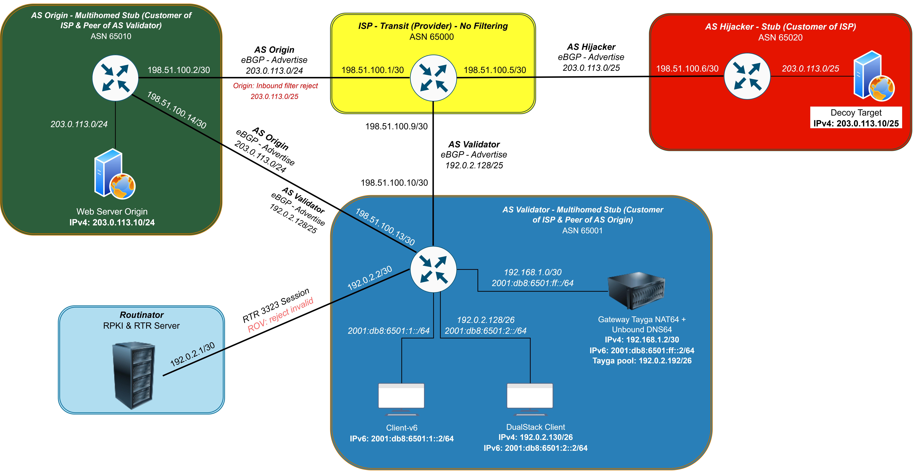
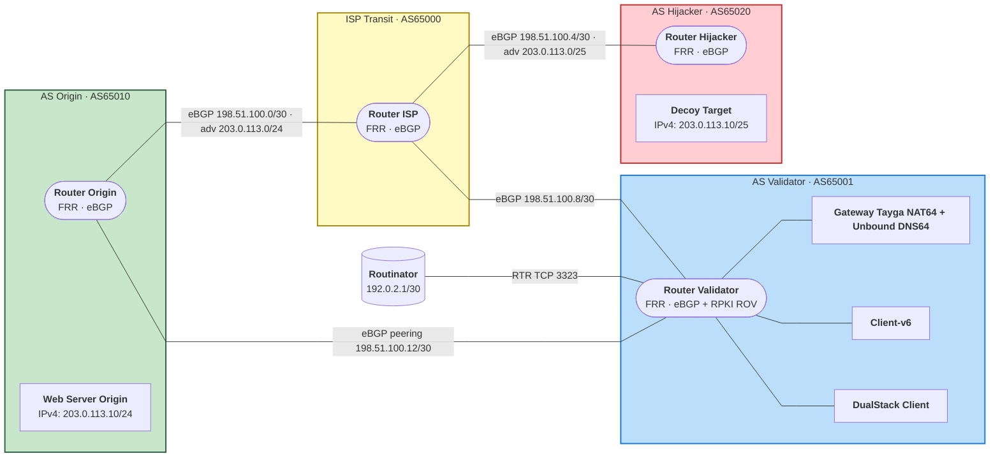

<p align="center">
  
</p>

# BGP Hijack, RPKI ROV & NAT64/DNS64 Lab

**A reproducible Containerlab lab where a hijacked route sends traffic to the wrong server, RPKI ROV pulls it back, and an IPv6-only client still reaches an IPv4-only service.**

**Four ASes. Ten nodes. One topology. Every claim is meant to be proven by CI, not by a screenshot.**

[](#project-status)
[](#limitations)
[](docs/implementation-notes.md)
[](docs/implementation-notes.md)
<!-- TODO: after the workflow exists, add the CI badge:
[](https://github.com/<user>/<repo>/actions) -->

🧭 [Why](#why-this-lab-exists) · 🧪 [What you should see](#what-you-should-see) · 🗺️ [Topology](#the-topology) · 🎓 [Lessons](#what-the-lab-makes-visible) · 🚀 [Run it](#run-it) · 📚 [Docs](#documentation-map) · ⚠️ [Limitations](#limitations)

> Aligned with **SDG 9: Industry, Innovation and Infrastructure**.

---

## Why this lab exists

Open a browser, type an address, and a page appears. Behind that click, thousands of independent networks agree on where your packets should go, and they agree mostly on trust. A network can announce a prefix it does not own, by mistake or on purpose, and its neighbors may simply believe it.

That is not a thought experiment. During a route leak on 1 May 2025, one AS spread about 4,651 extra routes in roughly three hours. APNIC's analysis found that 4,644 of them (about 99.85%) would have been flagged **RPKI-invalid** by a router doing validation. The tool exists. The gap is adoption: in Indonesia, ROA coverage jumped from 66.03% to 90.55% in three months, yet ROV adoption, the part where networks actually *reject* invalid routes, was only about 21.72% (APNIC Labs, 30 October 2025). Publishing a ROA is half the job. Someone still has to reject the invalid routes.

The second problem is quieter. IPv4 addresses are scarce, so more networks go IPv6-only, but plenty of services still speak only IPv4. An IPv6-only client cannot talk to them without a bridge: **DNS64** fabricates an IPv6 address for the destination, and **NAT64** translates the traffic. Many small operators have never built that bridge.

This repository puts both problems in **one** simulated network so you can break it, fix it, and watch the difference. The full story, sources, and research questions are in [problem-and-solution.md](docs/problem-and-solution.md).

## What you should see

The lab is designed around a handful of before-and-after observations. These are the **expected** results; once the automation lands, CI produces them in `results/latest.json` and fails the build if reality disagrees.

| Question | Condition | Expected result |
| :-- | :-- | :-- |
| Does a bogus `/25` really divert traffic? | ROV **off** | `curl -4 http://203.0.113.10` from the dual-stack client returns **"You've been hijacked"** |
| Does ROV stop it? | ROV **on** (reject-invalid) | The `/25` disappears from the BGP table and the same `curl` returns **"Welcome to Origin Server"** |
| What breaks when one NAT64 part is down? | DNS64 off and Tayga off → DNS64 only → both on | Fails to resolve → synthetic AAAA `2001:db8:6501:64::cb00:710a` but times out → **success** |
| Are the two halves really connected? | IPv6-only client through NAT64 | Hijacked while ROV is off, safe while ROV is on |

Step-by-step commands and pass criteria for every row are in [experiments.md](docs/experiments.md).

## The topology

Four autonomous systems share one Containerlab topology. A transit ISP that deliberately filters nothing connects an honest origin, a hijacker, and the network that runs validation. The validator also peers directly with the origin, and Routinator feeds it validated ROAs over RTR.

| AS | Role in the story |
| :-- | :-- |
| **AS65000** · ISP-Transit | Upstream for everyone, **no filtering** by design |
| **AS65010** · AS Origin | Rightful owner of `203.0.113.0/24`, runs `target-v4` |
| **AS65020** · AS Hijacker | Announces `203.0.113.0/25` without authorization, runs `decoy-target` |
| **AS65001** · AS Validator | Runs ROV, the NAT64/DNS64 gateway, and the test clients |



Addresses, eBGP links, routing policy per router, and the reasoning behind each design choice are in [topology-documentation.md](docs/topology-documentation.md).

## What the lab makes visible

Building this teaches four things that are easy to read about and surprisingly easy to get wrong.

1. **The more specific lie wins.** The hijacker never offers a "better" path. It offers a `/25`, and longest-prefix match does the rest, so the owner's `/24` loses without anyone doing anything clever.
2. **Routinator validates; the router rejects.** Routinator only produces the list of valid prefix-origin pairs. The decision to drop an invalid route is made by the router, through a route-map. That is why the ROV switch lives in FRR.
3. **Rejecting a route is not the same as being safe.** If the validator's only upstream is the ISP, it can throw the `/25` out of its own table and still send packets into the hijack, because the ISP still believes the lie. The direct peering with the origin is what gives ROV somewhere honest to send traffic.
4. **DNS64 invents the address; NAT64 does the translating.** Turn off either one and the failure looks different: no AAAA record in one case, a silent timeout in the other.

## How a run works

```text
containerlab deploy
  └─ wait for 4 eBGP sessions and the RTR session
      ├─ S0  baseline                  (hijacker silent, return path visible)
      ├─ S1  hijack, ROV off           → decoy
      ├─ S2  hijack, ROV on            → origin
      ├─ S3  DNS64 / NAT64 states      → fails · times out · succeeds
      └─ S4  integrated                → decoy · origin
  └─ pytest checks every expectation
  └─ Job Summary + results/latest.json
  └─ containerlab destroy (always, even on failure)
```

Evidence comes from the control plane (`vtysh` JSON), the forwarding plane (`show ip route`), and the application layer (`curl` and `dig`). The pipeline, results schema, and GitHub Actions workflow are in [automation-design.md](docs/automation-design.md).

## Run it

> 🚧 **Planned interface.** The `Makefile` and lab configs land with the implementation. Until then, the commands below describe the target, and the manual path is in [experiments.md](docs/experiments.md#e0-setup-and-deploy).

**Prerequisites:** a Linux host with Docker and [Containerlab](https://containerlab.dev), plus Python 3 with `pytest` for the assertions.

```bash
git clone https://github.com/<user>/<repo>.git
cd <repo>

make up      # build the gateway image and deploy the topology
make test    # run every scenario, then assert the expected results
make down    # tear the lab down
```

Something not working? Start with [implementation-notes.md](docs/implementation-notes.md). Every known pitfall is written as *symptom → cause → fix*, and each one is marked ✅ (settled) or ⚠️ (not yet verified on the versions in use).

## Tech stack

| Component | Tool |
| :-- | :-- |
| Routing | [FRRouting](https://frrouting.org) (eBGP, RPKI/RTR client) |
| Lab orchestration | [Containerlab](https://containerlab.dev) on Docker |
| RPKI validator | [Routinator](https://routinator.docs.nlnetlabs.nl) (NLnet Labs) |
| NAT64 / DNS64 | [Tayga](http://www.litech.org/tayga/) · [Unbound](https://nlnetlabs.nl/projects/unbound/about/) |
| Tests and CI | Python · pytest · GitHub Actions |

Why these and not the alternatives is covered in [implementation-notes.md](docs/implementation-notes.md#part-1-why-these-tools).

## Documentation map

The README only orients you. Each topic lives in exactly one document.

| Document | Read it when you want to... |
| :-- | :-- |
| [problem-and-solution.md](docs/problem-and-solution.md) | understand the two problems, the numbers behind them, and the research questions |
| [topology-documentation.md](docs/topology-documentation.md) | check addressing, eBGP links, per-router policy, and design decisions |
| [experiments.md](docs/experiments.md) | run the experiments step by step and know what "passed" means |
| [implementation-notes.md](docs/implementation-notes.md) | learn why each tool was chosen and avoid the known traps |
| [automation-design.md](docs/automation-design.md) | see how results are collected, asserted, and published by CI |

**Suggested paths.** Skimming? Read this page and stop. Reviewing the design? Go to topology, then problem-and-solution. Reproducing it? Go to experiments, with implementation-notes open beside it.

## Repository layout

```text
.
├── README.md
├── docs/                      # the five documents above, plus images/
│   └── images/topology.png    # static reference diagram
├── topology.clab.yml          # 🚧 Containerlab topology
├── configs/                   # 🚧 FRR, Routinator (SLURM), Tayga, Unbound
├── docker/lab-tools/          # 🚧 Tayga + Unbound and test tools image
├── scripts/                   # 🚧 run_experiments.py, write_summary.py
├── tests/                     # 🚧 pytest assertions
├── results/                   # CI artifacts (latest.json is ignored)
├── .github/workflows/         # 🚧 CI
└── Makefile                   # 🚧 up / test / down
```

## Project status

| Area | Status |
| :-- | :-: |
| Problem statement, topology, experiments, implementation notes, automation design | ✅ done |
| Containerlab topology and device configs | ✅ done |
| Experiment scripts, pytest assertions, CI | ✅ done |
| First published results in `results/latest.json` | ✅ produced by CI as an artifact |
| Dashboard in replay mode | 🔭 future |

## Limitations

A simulation earns trust by being honest about where it differs from reality.

- **The `/25` hijack is a lab quirk.** On the real Internet most networks drop IPv4 prefixes longer than `/24`, and a real sub-prefix attack is typically a `/24` against a `/23`. Here the `/25` spreads because ISP-Transit deliberately filters nothing, and the documentation range `203.0.113.0/24` is only a single `/24`.
- **ROV catches wrong origins, not forged ones.** Origin validation checks the prefix and the origin AS. A hijacker who forges the origin passes it, and stopping that takes AS-path validation such as ASPA or BGPsec, which is outside this lab.
- **The ROAs are local.** They are served through SLURM, not the global RPKI. The ASNs are private, which by definition cannot receive ROAs in the global RPKI.
- **Documentation ranges act as "public" only inside the lab.** Real clients would sit behind NAT44; it is skipped here to keep the moving parts down.
- **Not production-grade.** No redundancy or high availability. The unfiltered ISP is a deliberate setup for the experiment and says nothing about any real provider.
- **Timings are local.** Compare numbers only within the same environment (a laptop and a CI runner will differ).
- **Nothing touches the real Internet.** Every prefix and ASN comes from documentation or private ranges (RFC 5737, 3849, 6996, 6052).

## Future work

DNSSEC and KSK rollover · peering through an IXP route server instead of a direct link · ASPA · SNMP and telemetry · a replay-mode dashboard

## FAQ

**Is this connected to the real Internet?**
No. Everything runs inside Containerlab on documentation and private address space.

**Why FRRouting if the industry runs Cisco?**
FRR's `vtysh` CLI follows Cisco IOS conventions, so the concepts transfer directly, but FRR is open source and not a Cisco product. It also ships a built-in RPKI/RTR client.

**Why Containerlab and not GNS3 or EVE-NG?**
The whole topology is one YAML file and one command, which is what lets CI deploy, test, and destroy it on every change.

**Can I run it on a free cloud instance?**
Probably, since the lab is ten lightweight containers. On an ARM instance every image needs an `arm64` variant; see [implementation-notes.md](docs/implementation-notes.md).

## Found a pitfall?

Add it to [implementation-notes.md](docs/implementation-notes.md) in the same *symptom → cause → fix* format with a ✅ or ⚠️ label. If you open an issue, include your FRR, Routinator, Tayga, Unbound, and Containerlab versions, because much of the behavior depends on them.

## References

Sources and figures are listed, with their dates, in [problem-and-solution.md](docs/problem-and-solution.md#4-references).

## Author

- Ahmad Syafi Nurroyyan 
- github:
- linkedin

---

*Because the internet works on trust, and trust needs verification.*